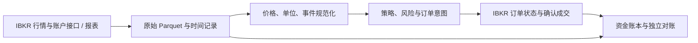

# 架构与扩展边界

2026-10-24：新研究主线为 `mine → backtest → decide`，职责和契约见
[量化重构方案](quantitative-research-refactor.md)与[P4 输出](research/p4-output.md)。
下文保留原 M1/M2/forward 架构说明，用于兼容与历史复现，不代表新主线仍使用旧策略模拟。
旧趋势/轮动实现现位于 `legacy_strategies.py`，共享组合模式位于 `portfolio_types.py`。

新目标架构见[量化研究框架重构方案](quantitative-research-refactor.md)：直接复用 Qlib
与 Alphalens，统一因子、信号、策略、回测和动作输出。[P1 数据接入](research/p1-data.md)
已通过本地离线验收，后续阶段待实施；以下保留既有实现与历史版本说明。

当前 `0.6.1` 流程：Alpaca 只读行情 API → 原始 Parquet 批次 → 标准化/质量准入 →
策略信号/目标/风险 → 单标的或共享现金逐日会计 → 独立对账 → Parquet 快照 → HTML/图表。
人工样例可直接走本地 Parquet 输入，但同样经过日历和对账检查。

目标来源统一为 **IBKR**，具体政策见 [数据来源决策](data-sources.md)。
M4 的目标数据流如下。`0.7.0` 已实现独立采集器、执行日志及离线演练，
研究引擎准入、正式资金映射及实际订单联调仍待验收，见 [M4 使用说明](ibkr-paper.md)：

行情、账户、委托、成交和费用采用 IBKR 外部记录；本地模拟只用于预测和工程测试，
不生成冒充券商确认的事件。来源更正保留原始批次和处理记录，不从其他供应商静默补齐。
现有 Alpaca 模块、已登记研究和冻结 M3 属于旧来源下的实现与证据，不随文档改名为 IBKR。
运行主机仍是项目资金账本的唯一写入端；券商余额快照不会自动替换项目预算和风险历史。

| 模块 | 职责 |
| --- | --- |
| market.py | 原始价格、日期、来源和企业行动的数据校验 |
| ibkr_gateway.py / ibkr_data.py | IBKR 只读接口、解码回执、独立调整价格模式及质量检查 |
| ibkr_execution.py / ibkr_store.py | Paper 执行意图、持久化状态恢复、确认成交与费用增量核对 |
| ibkr_cli.py / ibkr_synthetic.py | 手工采集/执行命令及明确 synthetic 的离线演练 |
| alpaca.py | 固定行情端点的只读请求、完整分页、精确金额和企业行动映射 |
| datasets.py | 不可变原始/标准化批次、失败隔离、文件校验和离线复现准入 |
| quality.py | 独立的 XNYS 日历、时间截点与完整性检查，生成 Parquet 质量报告 |
| dividends.py | 公共发行方原始响应的 Parquet 捕获、离线现金分红核对及来源绑定 |
| analysis.py | 已调整价格序列的独立统计，不参与成交 |
| config.py | TOML 研究参数和边界检查 |
| paper.py | 共用的次日成交、成本和行动会计，支持加仓/部分卖出；保留单标的策略入口 |
| risk.py | 共用的账户停用与单仓退出规则 |
| study_config.py / research_registry.py | 冻结 TOML 设计与引擎源码指纹、候选区间校验、登记和文件清单 |
| strategies.py | 趋势/轮动排序、目标权重、相关筛查及简单基准 |
| portfolio.py | 多标的共享现金、确定性成交顺序、总/单仓约束、完整逐日估值 |
| portfolio_audit.py | 独立重建共享现金、股数、应收、成本和利润归因，不调用 Account |
| evaluation.py | 含未平仓利润的成本后指标、敞口及年度市场环境对照 |
| research.py / research_report.py | 质量准入、搜索/选择/留出/滚动/压力、研究资格、重算及完整报告 |
| reconcile.py | 独立从资金流与成交重建逐日账目，不复用 Account 会计实现 |
| storage.py | 幂等更新、不可变快照、文件锁与当前快照切换 |
| report.py | 从结果表生成图表与报告 |
| forward_config.py / forward_engine.py | 冻结观察规则、持续共享资金与订单事件、精确风险状态恢复 |
| forward.py / forward_ops.py / forward_cli.py | 候选准入、原子日志、运行控制、日历任务、故障恢复和独立重建 |
| forward_versions.py / forward_migration.py | 显式版本边界、归档引擎前缀重放、备份及资金/风险状态等值迁移 |
| forward_service.py / notifications.py | 每次运行凭据、日结与备份、独立心跳检查、限制收件人的 Telegram 通知 |
| research_diagnostics.py / research_proposals.py | 封存结果的风险/归因复盘，假设、暴露截止日及未来窗口的原子登记 |
| cli.py | 命令行入口 |

历史回放与逐日累计更新使用同一套模拟会计逻辑。首版不引入数据库、Web 服务或券商
SDK。市场价格与金额采用 Decimal，收益比率与图表采用浮点；源数据和结果统一 Parquet。
M2 复用成交与企业行动核算，各标的账本通过组合层使用唯一现金余额；
独立对账从原始成交重建总账户，而不复用模拟的余额。源码和依赖版本随研究保存。
研究按区间重置独立实验账户，不具备 M3 持续资金账户的运行/迁移语义。
M3 `forward-*` 使用独立账户 UUID 和连续日志，复用 Account、信号、风险与独立审计；
只在实际观察时生成新决定。未经迁移的引擎变更被拒绝；现金/演练支持显式、状态等值的
版本迁移，旧区间继续由旧源码复核；策略资格和账务修订不自动迁移。
`invest audit` 可独立运行；同一套日历/结构检查已强制接入 `paper` 更新流程。范围和限制见
[数据约定](data.md#交易日历与质量报告)。

阶段、依赖和验收以 [项目总路线图](roadmap.md) 为准：真实行情与会计核对 →
策略/组合研究及独立验证 → 自有 paper 前向运行 → 外部执行一致性 → 受控实盘。
因子、网格和期权/杠杆研究在各自数据与验证前提满足后并行推进，不要求先接通券商。
扩展时继续保留并加强成交时序、会计核对和重启一致性测试。
