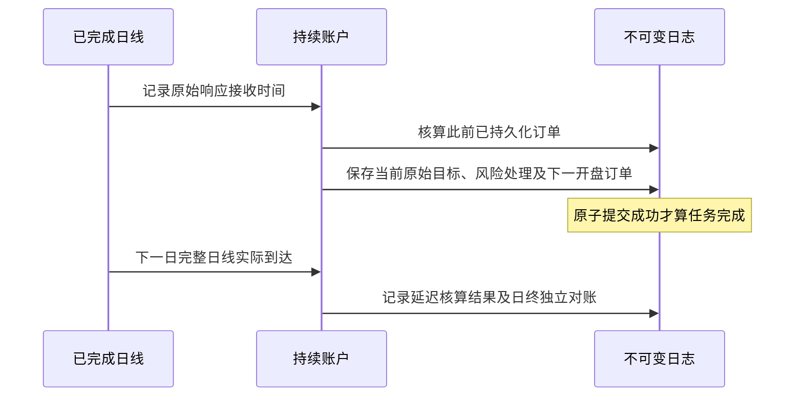

# M3 自有 paper 运行

`forward-*` 管理持续资金账户；M1 的 `paper` 与 M2 的 `research` 继续用于历史研究。
本版为单机、单写入进程、美元现金、多头整股和日线开盘代理，不接收券商成交。
金额、原始响应、账户、信号、订单、执行结果、对账及备份清单均为 Parquet/Zstandard。

## 运行用途

| mode | 用途 | 准入 |
| --- | --- | --- |
| `drill` | 合成故障与会计演练 | 输入必须标为 synthetic；可显式传 `--at` |
| `cash_observation` | 真实数据链路和现金账户运行观察 | candidate 必须为 cash，最低成交数为 0；不能产生买单 |
| `qualified_strategy` | 冻结候选的正式策略观察 | 提供通过 M2 的研究归档；完整重算、重新计算门槛，匹配引擎、参数、候选及准入标的 |
| `shadow_research` | 为另行登记的研究收集未来记录 | 真实已知历史研究归档，匹配引擎、参数、候选及标的；始终标记尚未取得正式资格 |

现有 M2 `rotation-60` 未通过门槛，因此本版不启动它的正式策略观察。
现金观察只积累运行可靠性证据，不验证策略收益。这些用途不能在已有账户内切换。
真实用途使用系统 UTC 时间，拒绝 `--at`；研究登记和输入中的历史时间不能替代当前决策时间。
2026-10-20 的 0.5.1 已修复 SPY 待支付分红查询范围，真实现金账户
`reports/m3-cash-account` 已登记，首个未来会话尚未核算。R1 长窗口研究仍失败，
没有启动候选账户；详情见 [M3 记录](milestones/m3.md)。
当前修复版为 0.5.2；上述账户仍冻结在 0.5.1，保留原身份与日志，使用归档引擎复核。
下列运行命令须使用对应账户的冻结版本；新版不会自动迁移或重新登记其资金。

## 开始前冻结

复制 [现金观察模板](../configs/m3-cash.toml)，在账户初始化前确定开始交易日、观察长度、
最低成交覆盖、行情最大接收年龄和标的。开始日必须是未来尚未开盘的 XNYS 会话；
预热数据必须刚好覆盖到此前一个交易日，且不少于策略/相关窗口要求。
模板默认 60 个交易日；它是工程观察方案，不是投资有效性阈值。

同一资金账户在 `journal/00000000/registration.parquet` 中保存 UUID、登记时间、
配置原字节、引擎、Python/包版本；源码和全部依赖版本另外归档。
初始化进入验证前即固定引擎指纹；资格重算、输入验证及最终发布期间发生源码变化会拒绝登记。
研究登记、研究清单、账户登记、归档源码和全部日志的引擎指纹必须一致，读取账户时也会核对。
账户目录已存在时禁止初始化，修改外部 TOML 不影响冻结配置。
当前版拒绝引擎变更，不提供就地策略替换或自动迁移。旧账户应保留，使用其归档版本运行；
新实验目录不能充当原资金账户的重置或恢复。跨版本迁移须另有状态等价和审计证据。

先使用只读 `fetch` 获取两个标的完整累计日线，使用 `capture-dividends` 获取当前发行方证据。
数据必须刚采集、通过完整日历与来源复现、发行方核对；最早响应超过登记的年龄上限即拒绝，
发行方证据也必须已经实际收到。输入起点应包含至少一笔可独立核对的分红事件：
当前发行方核对不把空参考集视作通过。使用 M2 默认窗口时建议保留至少半年预热。
企业行动按 `process_date` 查询，默认覆盖到当前 UTC 日期后 120 天，接纳当前已经返回的
待支付事件。实际接收时间仍是现在；未来除息不入既有账目，现金仍等支付日才入账。

```bash
uv run --locked invest forward-init \
  --config configs/m3-cash.toml --policy configs/m2.toml \
  --input SPY=data/alpaca/SPY实际批次 \
  --input XLF=data/alpaca/XLF实际批次 \
  --issuer-source data/issuer-当前捕获.parquet \
  --account reports/m3-cash-account

uv run --locked invest forward-status --account reports/m3-cash-account
```

正式候选使用 `mode="qualified_strategy"` 和 `--study <通过的研究归档>`；
观察起点必须晚于原研究留出终点。归档布尔值为 true 本身不足以通过，运行会核对并重算。
`shadow_research` 只接受 `known_history=true` 的真实归档，状态始终含
`formal_strategy_qualified=false`，每次报告同样标记尚未取得资格。
用途和研究版本冻结后不能改 TOML 升级，正式观察仍需另有证据、复核和登记。

## 每日任务与真实时序

推荐由可靠的外部调度器**每小时**执行一次下面的单次任务。程序内部依据 XNYS 日历、
半日市、夏令时及供应方截点判断是否有任务；无新会话就返回 `due: false`。
仓库不安装常驻服务，临时云工作区也不被当作可靠的全天运行主机。

```bash
uv run --locked invest forward-job \
  --account reports/m3-cash-account --data-root data/m3-forward
```

`forward-job` 在有任务时重新捕获发行方证据，再获取完整累计行情；失败批次保留，
每标的默认最多尝试两次（`--attempts 1..5`），不静默切换行情 feed。凭据只用于行情域名。
抓取前在账户锁下保存日志 head，网络请求不占用账户锁。提交成功或失败结果时会重新加锁；
若其他任务或人工控制已提交新日志，则返回 `updated=false, stale=true`，保留已捕获批次，
不再对当前账户应用旧结果。未被取代的抓取失败仍正常记录并暂停。
也可以通过 `forward-run --input SYMBOL=批次 ... --issuer-source 文件` 导入已捕获的批次。



Alpaca 日线保守等到次日纽约 00:15 后才接纳，因此“收盘决策”通常在次日凌晨实际发生。
订单的 `decided_at` 必须早于下一 XNYS 开盘，发布前还留一分钟安全余量。
`proxy_at` 是日线开盘价对应的拟成交时点，`recorded_at` 是实际事后核算时间；
二者不可混写成实时成交。没有已提交意图的历史日期不能补造买卖。

完整日线、分红和拆股在核算时才获知，不声称这些事件在原开盘前已核实；这仍是
日线代理的自有 paper 模型，不证明拍卖成交价、流动性、真实订单状态或历史公告可得性。

## 漏跑、暂停与修订

每次任务在同一账户锁下写入临时目录，完成所有表、报告、文件哈希和 fsync 后，
原子重命名为连续日志序号。目录重命名就是提交，不存在第二个需要同步的 CURRENT 指针。
崩溃前的临时目录不参与账户状态；提交后的重试读取已提交状态，同会话不会再成交。
日志包含父清单哈希、账户编号、操作人、原因和时间；`forward-verify` 逐事件重建状态，
再用独立组合审计重建现金、股数、分红、应收及收益归因。

缺失会话、过期/未来捕获、发行方冲突和历史修订会记录失败并暂停。复制成功的异常输入
仍保存在该次日志内，原先接受的数据和决定不改写。恢复后的累计数据可补齐估值和行动，
但只核算此前已经存在的有效订单，不生成漏跑日的策略决定；漏跑补偿后仍需人工复核恢复。
错过下一开盘的决策也会暂停，不能改写其时间后再下单。

```bash
uv run --locked invest forward-control --account reports/m3-cash-account \
  --action pause --actor owner --reason "数据差异待复核"
uv run --locked invest forward-verify --account reports/m3-cash-account
# 提供有效数据补齐账目后，才能恢复运行层
uv run --locked invest forward-control --account reports/m3-cash-account \
  --action resume --actor owner --reason "来源和账目核对完成"
```

暂停会取消尚未到拟成交时点的意图；已经越过时点的意图保留，等待有效数据核算。
验证失败后会重新读取系统时间并核对时钟与引擎，再确定取消范围；验证开始时尚未开盘、
失败时已经开盘的订单仍须核算，失败记录不会回填为任务开始时间。
恢复只改变运行层状态，不清除 `warning/halted/terminated` 风险锁，也不重置本金或净值高点。
暂停期间继续核算已有义务，但不产生新意图，包括新的风险退出意图；需要恢复有效数据和运行层，
风险已停用的账户才会继续安排退出，仍不能买入。停机本身不等于持仓已清空。
`stop` 只允许没有持仓、应收和待处理订单的账户，且不可恢复。

已确认的历史数据修订暂不自动应用到持续账本。保留原决定与修订批次，使用独立研究对照；
如无法恢复一致数据，账户继续暂停，人工账务调整/修订迁移仍需另行设计，不能换目录清零。

观察结束日由登记开始日和交易日数计算，不随结果改变。届时停止开仓并安排退出；
为清仓和应收结清所需的额外日不算延长观察窗口。`coverage_met` 要求原窗口内每天都有
及时决策记录、达到登记成交数且账户已结清；补录账目和清仓尾期不能补足原窗口的漏跑。
覆盖通过本身不等于策略有效性通过。

## 备份与恢复演练

```bash
uv run --locked invest forward-backup --account reports/m3-cash-account \
  --output reports/backups/m3-日期
# 单独保存命令返回的 head，恢复时核对；先停用原主机的任务
uv run --locked invest forward-restore --backup reports/backups/m3-日期 \
  --expected-head 返回的完整head --account reports/m3-restored \
  --actor owner --reason "原主机停止后的灾备恢复"
```

恢复保持同一账户 ID、资本、风险和完整历史；新副本默认暂停，记录恢复原因。
目标必须不存在，备份内容及外部提供的 head 必须一致。备份不能恢复尚未备份的提交，
不要把较旧备份当作当前账户。这里只提供单机锁，没有跨主机分布式锁；
**同一逻辑账户只允许一个运行副本**，恢复前需确认原调度已停止。

`make forward-demo` 在明确合成的时间轴上演练漏跑、风险退出、幂等和灾备，
结果位于 `reports/m3-demo/`。重复演练传新的 `M3_DEMO_DIR`，保留旧证据。
验收进度及真实观察边界见 [M3 记录](milestones/m3.md)。
