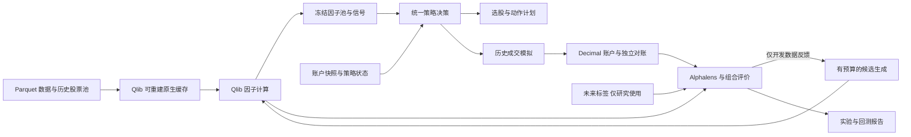

# 量化研究框架重构方案

日期：2026-10-23（北京时间）

基线：`be50c3c`，项目版本 `0.7.1`

状态：方案已确认，尚未实施。本次交付为文档，不代表依赖安装、代码重构、账户迁移或部署已经完成。
存储决策：2026-10-23 已确认权威表格数据和正式结果统一 Parquet，第三方库可使用可重建原生缓存。

## 1. 目标与范围

直接复用 **Qlib 和 Alphalens**，贯通“因子挖掘 → 信号 → 策略与组合 → 回测 →
选股和动作输出”。首版必须能生成、评价和淘汰因子，完成共享现金的组合回测，
并用同一决策规则产生当前投资计划；不能以预装指标或运行平台代替研究能力。

保持一个 Python 包、TOML 配置和三个主要命令。沿用 Python 3.12、uv、Decimal 会计和
独立对账；权威表格数据和正式结果表统一使用 typed Parquet/Zstandard，第三方库原生缓存
遵守第 2 节的派生数据边界。IBKR 仍是新外部行情、账户、
订单、成交和费用的唯一权威来源。首版限定日频、美元、多头、整股与现金，
先研究具备合格数据的价量因子；基本面因子需要另行证明历史公告时点与覆盖。

本次重构不安排自动实盘下单、部署切换、新账户登记、账户清零或风险限额放宽。
现有观察与运维继续使用原版本；其进度不能作为策略收益证明，也不阻塞离线研究。

## 2. 第三方库与自有代码的分工

| 依赖或参考 | 直接复用范围 | 项目负责的部分 |
| --- | --- | --- |
| `pyqlib`，导入名 `qlib` | 表达式与算子、原生数据 provider、`StaticDataLoader`、`DataHandlerLP`、`DatasetH`、可选模型 | Parquet 快照与原生缓存转换、内存视图、因果约束、候选搜索预算、因子池选择 |
| `alphalens-reloaded`，导入名 `alphalens` | RankIC、分组收益、换手、排名持续性与诊断 | 项目标签、覆盖检查、组合增量与交易成本评价 |
| LEAN、Zipline | 参考信号、组合目标和计算与执行分离的设计 | 小型、明确的决策与运行接口 |
| AlphaGen、RD-Agent | 参考候选生成、去冗余和实验反馈流程 | 首版实现受限模板与表达式枚举；后续生成器消费相同输入输出 |

Qlib、Alphalens 加入 `research` 依赖组，锁定已验证版本及传递依赖，不复制其源码。
实施第一步验证 Python 3.12 与现有 NumPy、pandas、PyArrow 的组合；包声明支持 Python
3.12 不等于本仓库已经安装通过。更新 `pyproject.toml` 与 `uv.lock` 时保持一致，
研究安装与检查入口明确包含该依赖组；既有独立 IBKR SDK 环境保持原职责。

数据接入分为权威存储、内存视图和库原生缓存三个边界：

- **权威存储：** 行情、企业行动、历史股票池、因子、标签、信号、动作、账本和正式结果表
  使用 typed Parquet/Zstandard。配置使用 TOML，业务数据不新增 CSV 或其他文本表格路径。
- **内存视图：** 按 Qlib、Alphalens 的接口构造 pandas/NumPy 的索引、列和数值类型；明确
  交易日历、证券身份、单位、可用时间与复权口径。浮点研究视图不得反向重建 Decimal 账本。
- **库原生缓存：** 允许 Qlib 等实际引入的库使用从指定 Parquet 快照及配置派生、可删除
  重建的原生格式，包括 Qlib `.bin` 字段和 `.txt` 日历、股票池。这些文本文件仅属于第三方
  缓存例外，不成为业务输入接口。缓存放在 `data/cache/<library>/<cache_id>/`，不提交 Git，
  不接收独立业务写入，也不作为第二份权威数据。

动态因子计算优先复用 Qlib 官方 Parquet 转换工具生成原生缓存，再使用其默认 provider
和表达式引擎；不再以自建 Parquet provider 为首版前置工作。预计算因子可以构造符合索引
和列分组要求的 Parquet 或 DataFrame，经 `StaticDataLoader` 接入研究流程；这条静态路径
不替代动态表达式计算。因子、信号与正式评价结果仍写回项目定义的 Parquet 表。

缓存标识和记录包含输入快照、股票池、时间范围、频率、转换器与库版本、相关参数、单位
和调整口径；表达式结果缓存另包含表达式和计算参数。同一输入的转换可复用，任一相关
输入变更即隔离或重建；切换快照必须隔离 Qlib 的全局配置与缓存。缓存清理只作用于对应
派生目录，不触及权威快照、账户与研究记录。首版串行运行，不引入数据服务器或分布式调度。

Alphalens 接收项目预先生成的未来收益表，经 `get_clean_factor` 等接口完成对齐与分组，
避免默认价格辅助函数把标签变成当天收盘买入。其 `factor_information_coefficient`
使用 Spearman 秩相关，报告明确命名为 RankIC；需要 Pearson IC 时独立计算并标明。
记录对齐、缺失和分组造成的样本损失，不能在丢失大量样本后只报告漂亮指标。

**最终资金曲线只由一套项目组合引擎产生。** Qlib 与 Alphalens 的因子收益、预测评价
用于研究诊断，不替代有限现金、整股、企业行动和费用约束下的 Decimal 账户核算。

## 3. 模块与统一数据对象

以下为目标职责划分，不要求一次性搬动全部文件，也不建设插件平台。

| 目标模块 | 职责 |
| --- | --- |
| `data` | IBKR 规范化、Parquet 快照、历史股票池、日历、质量、Qlib 原生缓存与内存视图适配 |
| `factors` | 调用 Qlib 计算、候选生成、去重、条件增量、冻结因子池 |
| `signals` | 将冻结因子经规则、排名或可选模型转换为信号 |
| `strategies` | 入场退出、策略状态、目标仓位、组合风险与动作规划 |
| `engine` | 历史时钟、决策调用、订单意图、模拟成交、现金持仓和会计 |
| `evaluation` | Alphalens 适配、组合与交易指标、基准、报告 |
| `experiments` | TOML 配置、搜索预算、样本分段、全部试验、版本和产物清单 |

共享类型集中在 `contracts.py`，避免第三方对象穿透所有模块。

| 对象 | 最小内容与约束 |
| --- | --- |
| `DataSnapshot` | 快照和来源 ID、证券身份、会话日期、OHLCV、企业行动、价格口径、数据可得与捕获时间 |
| `UniverseSnapshot` | 证券纳入与移出区间、筛选规则和依据；历史成员与当前名单分别标记 |
| `FactorFrame` | 日期、证券、因子 ID、数值、可用时间、表达式和输入快照引用 |
| `LabelFrame` | 日期、证券、预测期限、起止成交时点与收益；仅供训练和评价 |
| `SignalFrame` | 日期、证券、评分、排名、方向、期限、有效期及因子池或模型版本 |
| `DecisionPlan` | 当前与目标持仓、动作、数量、价型或触发条件、退出规则、有效期和解释 |
| `AccountSnapshot` / `StrategyState` | 现金、持仓、待处理订单、风险状态；另存入场依据、止损线、最高价和再入场状态 |

交易日使用交易所会话日期，时间戳保存 UTC；市场会话按纽约时区解释，面向用户可显示
北京时间。金额为美元 Decimal，股数为整数，费用率明确使用比例或 bps；因子与统计
可以使用浮点。数据的 `captured_at` 不冒充历史 `available_at`，无法证明的时点标记未知。
信号使用的调整价格与撮合、会计价格分开，不从调整价格推造分红现金流或拆股事件。

## 4. 因子挖掘首版流程

1. **固定研究输入。** 先登记股票池、数据版本、已知历史、训练/验证/测试区间、
   预测期限、交易成本、组合规则、搜索预算和选择标准；开发反馈不读取外层测试。
2. **生成候选。** 用趋势、反转、波动、量价等假设模板组合 Qlib 算子；限制窗口集合、
   表达式深度、复杂度和候选数量。保存种子、表达式、来源和生成顺序。
   校验语法树，只允许声明的字段及因果运算，禁止在特征中引用未来数据。
3. **计算与诊断。** 由 Qlib 计算，再用 Alphalens 检查 RankIC、分组收益、换手和
   持续性；同时记录缺失覆盖、异常、年份及行业稳定性。Alpha158/360 只作基线特征，
   不能作为候选生成已经完成的证明。
4. **去冗余与测增量。** 按表达式、数值相关性和风险暴露去重；在固定信号组合、仓位
   与退出规则下，比较加入候选前后的表现。因子方向、权重和模型仅用许可的开发数据选择。
5. **成本后回测与独立评价。** 将筛选后的信号送入项目组合引擎；检查净收益、回撤、
   恢复时间、完整交易、换手、费用及固定基准差异。记录全部尝试，控制多重试验；
   最后才运行封存测试，或执行只使用每折过去数据拟合和选择的 walk-forward。
6. **冻结因子池。** 保存合格因子的定义、方向、权重、数据版本、试验 ID 与依据。
   允许全部淘汰；输出 `rejected` 或 `insufficient_evidence`，不为了产生赢家放宽标准。

标签从下一允许成交时点起算。首版可统一定义为收盘形成特征、下一会话开盘至其后
第 H 个会话开盘的调整价格收益；H、价型与调整方法随实验冻结。此标签是预测目标，
不是账户收益。预处理只在训练段拟合；跨越分段边界的标签剔除，重叠标签的相关性纳入
切分和不确定性评价。任何参与反馈或人工选择的测试结果都变为已知数据。

历史股票池、退市、单位和企业行动覆盖不足时，明确哪些实验只能作限定范围的探索。
不能拿今天的名单回填历史并声称全市场有效；不能把旧 Alpaca 或发行方数据改名为 IBKR。
当前 IBKR 采集与原引擎之间的调整口径、企业行动缺口必须完成规范化后，才能进入相应
账户回测；计算出因子不自动意味着数据已具备账务资格。

## 5. 统一策略、回测与当前决策

策略接口表达为：`SignalFrame + AccountSnapshot + StrategyState + Policy → DecisionPlan`。
它不访问券商、不自行读取未来行情、不在内部修改账本。规则映射是首版默认，机器学习
模型为可选；选股规则、赋权和退出规则各自可测试，不把每个参数组合注册成独立策略类型。

历史回测和当前决策调用同一实现。相同数据截点、账户与策略状态、参数，必须产生相同
动作；回测引擎再根据下一时点的行情模拟成交，成交事件更新会计和策略状态。
当前决策使用明确来源和截点的账户快照，生成建议，不写入持续账户或发出券商订单。
漏跑的历史会话只能补账，不能补造当时已发布的交易建议。

策略负责止损止盈、趋势失效、持仓期限与再入场状态；组合层负责现金、集中度和账户
风险预算。明确退出、减仓、开仓的优先级，待处理订单计入预算，避免退出后同一信号立即买回。
新策略参数通过新研究确定，不追改旧账户的风险规则。

组合引擎支持单标的和多标的共享现金；保留分红应收/支付、已支持的拆股、费用、
部分成交与独立重建。默认收盘决策只能在后续会话成交，现金不足确定性缩量或拒单；
买卖顺序和可用资金政策显式配置，现金账户资金结算限制在数据不完整时明确披露。
保护性止损与收盘退出分别模拟；跳空不能保证按止损价成交。同根 K 线先后顺序未知时，
采用预先固定的保守规则或有资格的更细数据，不选择有利路径。

## 6. 现有文件处置

下列路径均相对 `src/invest/`。删除指新主线在替代实现验收后的清理，旧版本重放包不变。

| 处理 | 现有文件 | 目标 |
| --- | --- | --- |
| 保留并提取 | `paper.py` 的会计方法、`portfolio_audit.py`、`reconcile.py` | 会计与独立对账继续使用；选股、均线、策略退出状态移出 Account |
| 保留并精简 | `market.py`、`quality.py`、`datasets.py`、`storage.py` | 归入数据与产物存储，拆除旧来源和特定研究阶段耦合 |
| 保留 | `ibkr_gateway.py`、`ibkr_data.py`、`ibkr_models.py`、`ibkr_store.py`、`ibkr_execution.py`、`ibkr_synthetic.py`、`integrations/ibkr/`（仓库根目录） | 采集、执行与明确合成演练；增加研究数据适配，不重写 SDK |
| 重写 | `strategies.py`、`risk.py` | 因子、信号、策略与组合约束分离；旧趋势/轮动保留为回归基线 |
| 合并重写并删除重复逻辑 | `portfolio.py`、`forward_engine.py`、`paper.py` 的独立策略模拟 | 一个决策实现和共享资金引擎；历史、当前运行只改变数据与时钟驱动 |
| 合并重写 | `research.py`、`research_registry.py`、`research_proposals.py`、`research_diagnostics.py` | 统一实验、搜索、选择、重放和诊断；删除 M2/R1 固定候选与阶段分支 |
| 合并重写 | `config.py`、`study_config.py`、研究配置与 `cli.py` | 单份 TOML 定义数据、挖掘、信号、策略、成本和评价；提供三个主入口 |
| 合并重写 | `analysis.py`、`evaluation.py`、`report.py`、`research_report.py` | 复用统计与绘图，统一因子、组合、交易和动作报告 |
| 重写新版本绑定 | `engine.py` | 实验记录代码与依赖来源，金融行为版本与展示版本分开；旧指纹算法不追改 |
| 退出新主线、保留冻结重放 | `alpaca.py`、`dividends.py`、旧来源命令和配置 | 只服务原始来源下的历史复现，新研究不依赖它们补齐 IBKR |
| 冻结现有运行职责 | `forward.py`、`forward_config.py`、`forward_ops.py`、`forward_cli.py`、`forward_service.py`、`forward_versions.py`、`forward_migration.py`、`ibkr_observation.py`、`ibkr_cli.py`、`notifications.py` | 持续账户、迁移和运维仍按原版本运行；新研究不以完成这些流程为前置条件 |

旧 `paper`、M2/R1 和 `forward-*` 入口在替代路径验收前继续保留；之后从新主入口移除
重复研究入口，管理与历史重放按冻结版本文档调用。`deploy/` 不扩建也不随重构自动切换。
删除重复测试前，先在新公开接口上保留对应会计、时序、风险和幂等行为测试。

## 7. 命令、产物与选股动作

以下是待实现入口，不是当前版本可执行的使用说明。

| 命令 | 输入 | 输出 |
| --- | --- | --- |
| `invest mine` | TOML、数据快照、股票池与搜索预算 | 全部候选、诊断、拒绝原因、冻结因子池及实验引用 |
| `invest backtest` | 冻结因子池/模型、策略、区间、初始实验资金与成本 | 信号、动作、订单、成交、持仓、净值、独立对账、基准和分段评价 |
| `invest decide` | 冻结策略、截至当前的数据、账户与策略状态快照 | 股票排名和动作建议；不修改输入账户，不提交订单 |

命令的共同参数为 `--config`、`--output`，具体输入引用记录在 TOML；`decide` 另明确
决策截点。报告写入 `reports/<run_id>/`，数据写入 `data/`，均不提交 Git。
同一冻结实验重跑应复现；不同输入生成新记录，不能覆盖已有选择或结果。

| 产物 | 必需内容 |
| --- | --- |
| `run.parquet`、`trials.parquet` | 配置正文、代码和依赖版本、输入引用、样本分段、搜索预算、全部尝试与状态 |
| `factors.parquet`、`labels.parquet`、`factor_pool.parquet` | 特征与标签分开、表达式、权重、版本、冻结和筛选依据 |
| `rankings.parquet` | 股票身份、评分与排名、入选/淘汰原因、因子贡献、数据截点、覆盖与证据状态 |
| `actions.parquet` | 动作 ID、证券、`BUY/ADD/TRIM/SELL/HOLD/WAIT`、当前/目标数量、差额、价格或触发条件、退出规则、有效期、原因及版本引用 |
| `orders.parquet`、`fills.parquet`、`positions.parquet`、`equity.parquet` | 模拟执行与账户轨迹，明确 synthetic、历史模拟或券商确认来源 |
| `metrics.parquet`、`checks.parquet`、`report.html` | 因子与组合评价、完整交易胜率和 R 倍数、费用/基准、对账、限制和可读报告 |

上述为按命令生成的最小产物集合，不要求每个命令输出全部表。选股评分不解释为未经
校准的获利概率。动作考虑现有持仓和待处理订单；高排名但超配可以是 `TRIM`，超价或
不满足准入条件可以是 `WAIT`。数据失效不能被输出成“账户已安全处理”；已有持仓的
退出需求单列为待核实或待执行事项。没有合格因子时保留明确失败结果，不伪造买入计划。

## 8. 历史账户与研究保留

1. 盘点并保留旧源码、锁文件、注册、输入、研究结果、journal 和版本边界；先验证原版
   重放，再清理新主线代码。旧报告、失败结论与来源标记不改写。
2. 新研究使用新实验 ID。历史研究可用已知数据作开发，但不能把重新下载或重新命名
   当作新的样本外；既有 R1 未来方案继续使用原冻结源码、参数、区间和依赖。
3. 持续资金账户保留 ID、本金、净值高点、风险状态、观察窗口和唯一权威写入端。
   本地副本不并行写入；重构不触发新账户、清零或自动恢复暂停状态。
4. 2026-10-23 的旧现金观察归档及 `m3-ibkr-cash-v1` 新登记是已明确授权的单次例外，
   不构成重构时再次重置账户的依据。以后如需迁移，仍按既有适用范围、预期 head、
   来源引擎、已验证本机备份、actor/reason 和状态等值流程单独处理。
5. 备份只留部署主机，不新增异地存储、传输签名或证书要求。文档重构不改变当前部署。
6. 原生缓存是新增派生产物，不迁移或转换原有账户与研究档案；生成、清理、重建缓存均
   不得覆盖、删除或重标原记录，也不得改变本金、风险状态或样本外资格。

## 9. 实施顺序与验收

所有阶段当前均为待实施。阶段完成表示能力与证据到位，不表示策略获利或获得实盘资格。

| 阶段 | 交付 | 必须通过的验收 |
| --- | --- | --- |
| P1 依赖与数据 | 锁定 Qlib/Alphalens、统一类型、Parquet 快照到 Qlib 原生缓存及内存视图、旧行为基线 | Python 3.12 锁定依赖安装、测试离线运行；小样本因子与手算一致；删除缓存后可重建且结果一致，快照或参数变更不误用旧缓存；Decimal 原值与历史记录未变；已知缺口明确拒绝或降级 |
| P2 挖掘与信号 | 有预算候选生成、Alphalens 诊断、去冗余、冻结因子池、SignalFrame | 确实生成与淘汰候选；标签和训练边界正确；保持历史快照时追加未来数据不改变过去特征，修改封存测试不改变开发选择；全部失败可复查 |
| P3 统一策略与回测 | 共享决策、单/多标的引擎、成本、退出与独立对账 | 相同截点及状态的回测/每日动作一致；保持旧策略语义时现金、成交、持仓与原版一致；跳空、部分成交、分红、拆股和重跑行为正确 |
| P4 输出与清理 | 三个主入口、选股动作表、报告、旧主线路径删除 | 从挖掘到回测再到当前决策完整离线演示；真实数据另列准入证据；原版本可重放；无账户或部署副作用 |

每阶段运行 `make check`；集成验收运行 `make demo`、研究离线演示和 `make build`。
依赖安装使用 `uv sync --locked --python 3.12`，研究入口另包含已声明的 `research` 组。
金融引擎变更后的 M1 演示必须使用新的 `DEMO_ACCOUNT`；涉及前向引擎时运行
`make forward-demo M3_DEMO_DIR=reports/<new-name>`。这些都是合成演示，不重置持续账户。
测试与构建不依赖市场 API 或账户凭据；文档阶段只检查链接、差异与现有仓库检查结果。

首版完成的判据是：候选实际生成并被筛选或全部淘汰；一套完整策略完成可逐笔复核的
组合回测和独立评价；相同规则可以生成当前排名与动作。需要分别报告工程是否完成、
数据是否合格、策略证据是否充分，不把“存在一条收益曲线”作为成功。

## 10. 依据与相关记录

- [数据格式兼容性调研](research/data-format-compatibility.md)：14 个项目的存储与内存接口核查；Parquet 权威存储和库原生缓存的边界已采纳，实现兼容性仍由 P1 验证。
- [Qlib 数据 provider](https://github.com/microsoft/qlib/blob/main/qlib/data/data.py)、[数据处理](https://github.com/microsoft/qlib/blob/main/qlib/data/dataset/handler.py)、[依赖声明](https://github.com/microsoft/qlib/blob/main/pyproject.toml)：支持直接复用与本地适配，具体版本由 P1 锁定。
- [Alphalens 数据对齐](https://github.com/stefan-jansen/alphalens-reloaded/blob/main/src/alphalens/utils.py)、[统计实现](https://github.com/stefan-jansen/alphalens-reloaded/blob/main/src/alphalens/performance.py)、[依赖声明](https://github.com/stefan-jansen/alphalens-reloaded/blob/main/pyproject.toml)：用于诊断，不替代账户回测。
- [LEAN 决策分层](https://www.quantconnect.com/docs/v2/writing-algorithms/algorithm-framework/overview)、[Zipline 计算图](https://github.com/stefan-jansen/zipline-reloaded/blob/main/src/zipline/pipeline/engine.py)、[AlphaGen](https://github.com/ICT-FinD-Lab/alphagen)、[RD-Agent](https://github.com/microsoft/RD-Agent)：结构与研究流程参考。
- 项目约束见 [AGENTS.md](../AGENTS.md)、[数据来源决策](data-sources.md)、[数据约定](data.md)；历史研究见 [M2 使用说明](research/README.md)、[R1 失败复盘](research/r1-postmortem.md)、[冻结未来研究](research/r1-capital-budget.md)；持续账户规则见 [前向运行](forward.md)与[IBKR 现金观察](ibkr-cash-observation.md)。
