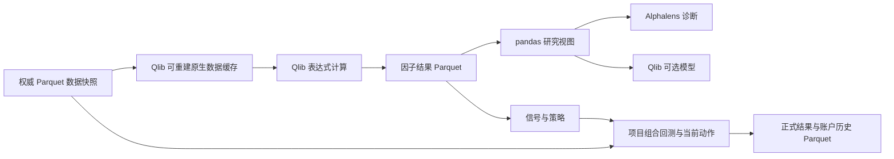

# 量化库数据格式与 Parquet 兼容性调研

核查日期：2026-10-23。覆盖前次研究的 14 个项目，重点是拟直接引入的 Qlib、Alphalens。
证据来自官方文档和源码；本地只验证了 Arrow、Parquet、pandas 的小样本转换。
未安装或运行这些量化库，未完成跨库兼容性测试或性能基准。

以上是调研时的验证范围。后续已开始 P1 实现，实际发布包接入与离线验证单独记录在
[P1 数据接入](p1-data.md)，不将后来的结果追认为本次调研已完成的实测。

## 1. 结论

**Parquet 适合作为本项目权威表格数据和正式研究结果的统一存储格式；不应要求所有库的
内部运行格式也必须是 Parquet。** 前者保留强类型、Decimal、来源和历史，后者会迫使我们
重写库已经实现的数据层，与缩小框架、直接复用库的目标冲突。

实际交集有两类：

- 文件交集：Qlib 的静态数据加载器可以直接读取 Parquet；RD-Agent 的合并因子阶段已使用
  这条路径；vn.py 的 Alpha 研究模块、NautilusTrader 和 Freqtrade 也有原生 Parquet 路径，
  各自要求对应的 schema、目录或文件命名。
- 内存交集：Qlib、Alphalens 和多种 Python 回测库接受 pandas/NumPy。Parquet 可以作为共同
  来源，读取后构造各库需要的索引、列和数值类型；它们不是共享一个完全相同的 DataFrame。

该结论已于 2026-10-23 经用户确认，纳入[重构方案](../quantitative-research-refactor.md)
和 [AGENTS.md](../../AGENTS.md)：保留 Parquet 权威存储，允许可重建的库原生缓存。
本轮仅更新文档，未改代码、依赖或历史数据，缓存接入仍待实施。

## 2. 各库支持的格式

“可经 pandas 接入”表示有明确的内存接口，不表示库原生认识任意 Parquet 文件。

| 库 | 默认存储或主要输入 | 与 Parquet 的交叉及限制 |
| --- | --- | --- |
| Qlib | 默认行情字段为 `.bin`，日历和股票池为 `.txt`；研究数据为 pandas | `StaticDataLoader` 直接读取预计算表的 Parquet；官方 `dump_bin.py` 支持将 Parquet 行情转换成原生格式。表达式 provider 默认不直接查询任意 Parquet。[加载器][qlib-loader]、[转换器][qlib-dump]、[存储][qlib-storage] |
| Alphalens-reloaded | 因子 Series、未来收益 DataFrame，使用日期与证券的 MultiIndex | 不要求自己的磁盘数据库；Parquet 经 pandas 读取、对齐后传入分析函数。[接口][alphalens-utils] |
| RD-Agent，Qlib 场景 | 价量样本和单因子接口仍用 HDF5；合并因子用 Parquet | 已有 `combined_factors_df.parquet` → Qlib `StaticDataLoader` 的直接连接；不能把这一阶段推广为全链路只用 Parquet。[runner][rd-runner]、[配置][rd-config]、[单因子接口][rd-factor] |
| AlphaGen | Qlib 数据，经 pandas 转为 PyTorch tensor | 默认通过 `QlibDataLoader`，随后生成日期×特征×股票的浮点 tensor；此路径没有直接读取 Parquet。[源码][alphagen-data] |
| LEAN | 标准行情文件为 ZIP 内 CSV/JSON；运行时为类型化行情对象 | 标准读取路径不是通用 Parquet reader；需转换或自定义 provider。Python history 返回 pandas 是输出能力。[格式][lean-format]、[历史响应][lean-history] |
| Zipline-reloaded | bundle 使用 bcolz 行情和 SQLite 资产、调整数据 | 完整回测需 ingest；Pipeline 的 `DataFrameLoader` 能接内存宽表，但不替代整个回测数据层。[bundle][zipline-bundle]、[loader][zipline-loader] |
| vectorbt，开源版 | pandas Series/DataFrame、NumPy 数组 | 可以从 Parquet 构造价格矩阵后传入 Portfolio；不是要求一个原生行情文件格式。[源码][vectorbt-input] |
| bt | pandas 价格宽表 | Parquet 读入后转成日期索引、证券列的价格表；需满足排序等约束。[源码][bt-input] |
| NautilusTrader | `ParquetDataCatalog`，框架定义的 Arrow schema 和类型 | 原生 Parquet，但本项目的任意长表不能直接作为其 catalog；仍需适配类型、精度、时间和目录。[官方文档][nautilus-catalog] |
| Backtrader | CSV 等 feed，以及 pandas DataFrame；内部按 lines 推进 | 可先读 Parquet，再传 `PandasData` 并映射日期、OHLCV；不能据此声称原生解析 Parquet。[PandasData][backtrader-input] |
| vn.py | 主交易数据库默认 SQLite；AlphaLab 行情和信号原生存 Parquet | Alpha 研究路径直接支持；AlphaDataset 使用 Polars，诊断再转 pandas。须与交易数据库路径区分。[AlphaLab][vnpy-lab]、[AlphaDataset][vnpy-dataset]、[交易设置][vnpy-setting] |
| RQAlpha | 标准 bundle 行情与调整数据主要为 HDF5，另有 JSON 元数据 | 默认不是 Parquet reader；需转换 bundle 或自定义数据源。[数据源][rqalpha-source]、[存储][rqalpha-storage] |
| backtesting.py | OHLCV pandas DataFrame；不规定磁盘格式 | Parquet 读成规定的 DataFrame 后接入；策略内部使用数组包装对象。[输入接口][backtesting-input] |
| Freqtrade / FreqAI | 行情默认 Feather，也有 JSON、Parquet handler | stable 有原生 `ParquetDataHandler`；须符合其字段与命名，模型产物另论。[文档][freqtrade-format]、[handler][freqtrade-parquet] |

这些格式说明不代表建议同时引入所有库。首版仍只直接依赖 Qlib、Alphalens；其余用于
核对设计与保留后续候选生成器的接入可能。

Freqtrade 文档正文仍有“Parquet 仅 OHLCV”的描述，但同页 CLI 的 trades 选项和 stable
源码已提供相应支持；这里按已核查的 handler 能力记录，不据旧句子推断当前限制。
[数据格式][freqtrade-format]、[Arrow handler][freqtrade-arrow]

## 3. Qlib 与 Alphalens 的最短接入路径

Qlib 有两条不同的数据路径，不能混淆：

1. **预计算因子或模型输入：** Parquet → `StaticDataLoader` → `DataHandlerLP` / `DatasetH`。
   这条路径已经存在，不需要实现新的文件 reader。表必须符合日期、证券索引，以及
   `feature` / `label` 列分组等约定；项目自己的长表需要先构造这样的视图。
2. **利用 Qlib 算子动态计算因子：** 原始行情 → provider → `D.features` / `QlibDataLoader`。
   默认文件 provider 使用 `.bin` 等原生数据。官方转换工具可直接读 Parquet，无须先落 CSV。
   另一选择是自定义 Parquet provider，但需要承担日历、证券区间、字段切片和缓存适配工作。
   仅使用 `StaticDataLoader`，不能替代这条动态表达式计算路径。[加载器][qlib-loader]、[转换器][qlib-dump]

Alphalens 的 `get_clean_factor` 接受 `(date, asset)` 索引的因子 Series，以及相同索引的
未来收益 DataFrame。Qlib 常用 `(datetime, instrument)`；两者可以通过明确的内存视图互转，
但还要处理列结构、时区、排序、交易日历和样本损失。未来收益列如 `1D`、`5D` 的命名及
日期频率有接口要求，不能只把文件读出来就视为兼容。[接口][alphalens-utils]

本项目仍自行定义“下一允许成交时点起算”的 LabelFrame，再交给 Alphalens；因子评分与
资金账户收益继续分开。文件格式相同，不会自动保证预测期限、复权口径或因果关系相同。

RD-Agent 给出了实际交叉案例：当前 runner 将合并因子保存为 Parquet，再用 Qlib 的
静态加载器读取；源码说明由 pickle 改为 Parquet 是为解决跨容器 NumPy 版本的兼容问题。
但单因子执行器仍读取 `result.h5`。未来若接入其完整流程，HDF5 也应是隔离的运行产物，
不能据此要求整个项目换格式。[runner][rd-runner]、[配置][rd-config]、[单因子接口][rd-factor]

## 4. 已确认的数据边界

上图中的库原生缓存边界已确认，当前尚未实施。遵守三条规则：

1. **权威记录仍为 typed Parquet + Zstandard。** 行情、企业行动、历史股票池、因子、信号、
   动作、账户账本和正式研究结果保留本项目 schema。旧账户与研究记录不转换、不覆盖。
2. **计算接口按库转换。** Arrow 负责类型和读写，pandas/NumPy 负责研究视图；需要 tensor 时
   在对应库边界转换。不让第三方索引名称成为整个项目的领域模型，也不新建通用数据平台。
3. **库原生格式仅作可重建产物。** Qlib 的 `.bin`、日历及股票池文件由指定 Parquet 快照派生，
   放在 `data/cache/<library>/<cache_id>/`，忽略 Git。记录输入快照、转换器、库版本、相关
   参数、单位和调整口径；删除后可重建，清理不触及权威快照、账户与研究记录，
   不接收独立业务写入，不作为第二份权威行情或账户。切换快照时隔离 Qlib 全局配置和缓存。

不必为参考库提前建设 HDF5、bcolz 等出口。只有实际采用相应流程时，才增加必要转换。
同一快照的转换应复用，不能每计算一个因子就重新转一遍完整行情。

## 5. 精度、性能与验证

Parquet 的 DECIMAL 逻辑类型保存精度和小数位，适合本项目已有的金额字段。当前代码中，
`market.py` 使用 `decimal128(24, 6)`，`ibkr_data.py` 使用 `decimal128(38, 18)`。
Qlib 默认文件存储则以小端 float32 写入字段；这是研究计算表示，不能拿来重建精确账本。
[Parquet 类型规范][parquet-types]、[Qlib 文件存储][qlib-storage]

本地使用合成数据做了一次临时文件往返验证，未读取账户或真实行情：

| 检查 | 结果 |
| --- | --- |
| Arrow schema 与 Decimal 经 Zstandard Parquet 写入再读取 | 保持一致 |
| pandas 默认读取金额列 | `object` 列，值为 `Decimal` |
| 显式构造研究表 | 日期、证券 MultiIndex，因子为 float64 |
| `Decimal('123.456789')` 转 float32 的示例 | `123.456787109375`，说明存在精度损失 |

验证环境为本仓库锁定依赖：Python 3.12.13、PyArrow 24.0.0、pandas 3.0.6、NumPy 2.5.4。
这只证明上述转换行为；不证明 Qlib、Alphalens 已安装兼容，也不证明全链路收益正确。

Parquet 适合列式批量读写；Arrow 与 pandas 互转并非总能零拷贝，空值、类型和分块可能触发
复制。长表转宽表、全量读取、反复落盘也可能成为成本。现阶段没有依据声称 Parquet 或 Qlib
原生格式在本项目快多少；实施时用代表性股票池测冷加载、重复因子计算、内存和缓存空间即可。
[Arrow Parquet][arrow-parquet]、[Arrow 与 pandas][arrow-pandas]

Parquet 文件也不替代账户的提交、并发写入与幂等逻辑。现有追加历史、单一权威写入者和
Decimal 对账约束继续由项目保证，不能因为换了计算库而省略。

## 6. 已采纳的方案修订

[重构方案](../quantitative-research-refactor.md)第 2 节已取消所有持久化缓存都必须使用
Parquet 的限制，采用以下规则：

> 权威表格数据和正式结果统一使用 typed Parquet/Zstandard。计算时使用库要求的内存结构；
> Qlib 等第三方库可以使用从指定快照生成、可删除重建的原生缓存，缓存不得成为业务事实源。

[AGENTS.md](../../AGENTS.md)已同步限定：不新增 CSV 或其他文本表格业务数据路径；
Qlib 原生 `.txt` 日历和股票池等仅作为可重建派生缓存的例外。历史账户、登记、来源、
journal、冻结输入、研究结果、风险历史和样本外状态保留；缓存操作不得改写这些记录。

首版优先复用 Qlib 官方转换工具与默认 provider，不要求自建 Parquet provider。
P1 须验证缓存删除重建、输入变更隔离、计算一致性与 Decimal 原值保留。本轮未生成缓存、
迁移数据或修改实现，不能把规则更新视为接入完成。

[qlib-loader]: https://github.com/microsoft/qlib/blob/main/qlib/data/dataset/loader.py
[qlib-dump]: https://github.com/microsoft/qlib/blob/main/scripts/dump_bin.py
[qlib-storage]: https://github.com/microsoft/qlib/blob/main/qlib/data/storage/file_storage.py
[alphalens-utils]: https://github.com/stefan-jansen/alphalens-reloaded/blob/main/src/alphalens/utils.py
[rd-runner]: https://github.com/microsoft/RD-Agent/blob/484776c211e4fbbeef03e0ec00d6bbee7362a4f4/rdagent/scenarios/qlib/developer/factor_runner.py
[rd-config]: https://github.com/microsoft/RD-Agent/blob/484776c211e4fbbeef03e0ec00d6bbee7362a4f4/rdagent/scenarios/qlib/experiment/factor_template/conf_combined_factors.yaml
[rd-factor]: https://github.com/microsoft/RD-Agent/blob/484776c211e4fbbeef03e0ec00d6bbee7362a4f4/rdagent/components/coder/factor_coder/factor.py
[alphagen-data]: https://github.com/ICT-FinD-Lab/alphagen/blob/259687e8f316994426416c530a94842a2fe6405e/alphagen_qlib/stock_data.py
[lean-format]: https://www.quantconnect.com/docs/v2/lean-engine/data-format/key-concepts
[lean-history]: https://www.quantconnect.com/docs/v2/writing-algorithms/historical-data/history-responses
[zipline-bundle]: https://github.com/stefan-jansen/zipline-reloaded/blob/main/src/zipline/data/bundles/core.py
[zipline-loader]: https://github.com/stefan-jansen/zipline-reloaded/blob/main/src/zipline/pipeline/loaders/frame.py
[vectorbt-input]: https://github.com/polakowo/vectorbt/blob/master/vectorbt/portfolio/base.py
[bt-input]: https://github.com/pmorissette/bt/blob/master/bt/backtest.py
[nautilus-catalog]: https://nautilustrader.io/docs/latest/concepts/data/catalog/
[parquet-types]: https://parquet.apache.org/docs/file-format/types/logicaltypes/
[arrow-parquet]: https://arrow.apache.org/docs/python/parquet/index.html
[arrow-pandas]: https://arrow.apache.org/docs/python/pandas.html#memory-usage-and-zero-copy
[backtrader-input]: https://github.com/mementum/backtrader/blob/master/backtrader/feeds/pandafeed.py
[vnpy-lab]: https://github.com/vnpy/vnpy/blob/c6e231caf32b7fc97e6459817fff66458cf7e7c4/vnpy/alpha/lab.py
[vnpy-dataset]: https://github.com/vnpy/vnpy/blob/c6e231caf32b7fc97e6459817fff66458cf7e7c4/vnpy/alpha/dataset/template.py
[vnpy-setting]: https://github.com/vnpy/vnpy/blob/c6e231caf32b7fc97e6459817fff66458cf7e7c4/vnpy/trader/setting.py
[rqalpha-source]: https://github.com/ricequant/rqalpha/blob/master/rqalpha/data/base_data_source/data_source.py
[rqalpha-storage]: https://github.com/ricequant/rqalpha/blob/master/rqalpha/data/base_data_source/storages.py
[backtesting-input]: https://github.com/kernc/backtesting.py/blob/master/backtesting/backtesting.py
[freqtrade-format]: https://docs.freqtrade.io/en/stable/data-download/#data-format
[freqtrade-parquet]: https://github.com/freqtrade/freqtrade/blob/stable/freqtrade/data/history/datahandlers/parquetdatahandler.py
[freqtrade-arrow]: https://github.com/freqtrade/freqtrade/blob/stable/freqtrade/data/history/datahandlers/arrowdatahandler.py
