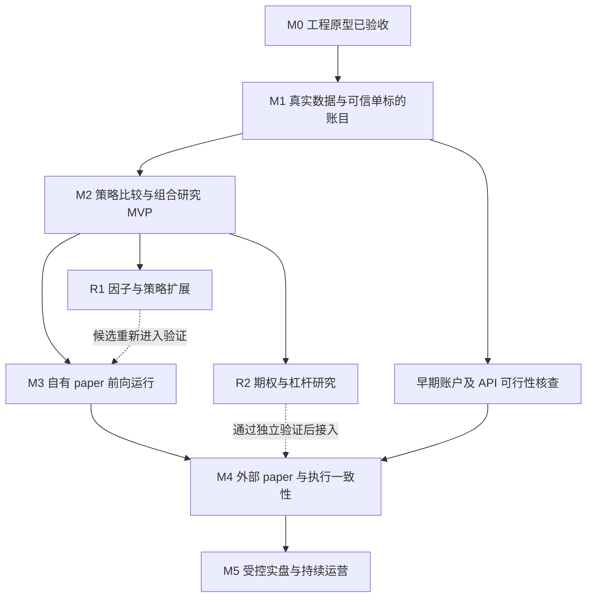

# Invest 项目总路线图

版本：v8 · 更新日期：2026-10-22（北京时间）

本路线图以当前工作区实现、项目交接说明和后续讨论为依据。目标是为一个独立的
5,000 美元账户建设可复现的美股投资研究、模拟运行和最终执行系统。
M1 数据与账目、M2 策略/组合研究已完成；M3 运行工程已实现，正式策略观察仍待候选资格与实际观察证据。

阶段按验收证据推进，不预先承诺收益或实盘上线日期。工程能力完成、策略通过研究验证、
账户获准运行是三件不同的事；没有策略通过验证时，保留现金和继续研究也是正常结果。

## 1. 项目边界与决策状态

### 已明确的边界

| 项目 | 约定 |
| --- | --- |
| 资金与账户 | 独立验证项目，初始本金 5,000 美元；最终目标执行账户为嘉信国际账户，具体权限待核实 |
| 投资目标 | 追求较快增长，接受风险，不承诺固定收益；没有强制持有期限 |
| 投资范围 | 股票与 ETF 为主；允许受限使用期权和杠杆，禁止末日期权 |
| 本金警戒 | 净值低于 4,000 美元进入警戒 |
| 项目终止 | 净值达到或低于 2,500 美元，停止策略并启动清仓；成交价格可能因跳空或流动性偏离触发线 |
| 日常风险 | 独立管理单笔退出、单仓利润保护和账户高点回撤，不能只盯本金是否亏损 |
| 数据标准 | 行情、企业行动、研究结果、账户账本统一使用 Parquet；人工配置使用 TOML |
| 前期运行 | 先维护项目自己的 paper 账户；Alpaca 等外部 paper 服务按验证需要再接入 |
| 需求范围 | 不引入此前其他投资计划、持仓或资产偏好，不重复开展家庭财务问卷 |

### 当前工程选择，不等于实盘参数

Python 3.12、uv、PyArrow、pandas、NumPy 和现有测试体系继续沿用。
原始价格和账目使用 Decimal，Parquet 使用 Zstandard 压缩；先做日线、多头、整股和现金。

现有 80% 开仓资金分配、8% 单仓止损、12% 单仓利润回撤、15% 账户高点回撤，以及
警戒后退出并停用，都是研究默认值或原型实现选择。均线窗口、模拟费用和滑点同样需要
研究验证，不能当作用户已批准的投资规则。实际值与行为见 [Paper 说明](paper.md)。

期权准入期限、允许结构、敞口预算、杠杆工具与上限、风险停用后的恢复条件仍待设计。
这些由项目研究形成方案，不作为现在必须向用户追问的前置条件。

## 2. 当前实现与差距

当前包版本为 `0.6.1`，M1/M2 已完成，M3 持续账户、显式迁移、调度及恢复工程已实现；
具体提交标识以 Git 历史为准。下面的“已实现”描述经过本地验证的能力，
不代表已经完成云环境发布、真实前向观察或实盘验证。

| 领域 | 当前能力与证据入口 | 下一步缺口 |
| --- | --- | --- |
| 工程基础 | uv 锁文件、CLI、Ruff、mypy、pytest、打包；M2 基线 `7938e48` 已推送且 CI 通过，M3 验证见阶段记录 | 为后续阶段继续保留独立版本和验收证据 |
| 数据 | M1 SPY 与 M2 SPY/XLF 原始 SIP 数据通过质量、离线复现和发行方核对；M2 覆盖到 2026 上半年；不支持的 XLK/旧历史隔离 | 更早历史的支付日/精度、历史发布时间及其他事件类型 |
| 策略 | 趋势/轮动两类、6 个冻结候选、4 个基准；年度市场涨跌分类；首轮选择未通过留出门槛 | 新候选的冻结研究、未见数据或前向证据 |
| 成交 | 收盘决策、下一交易日有效订单、日线开盘代理、整股预算、费用和滑点；零量整段拒绝 | M3 已分离提前保存的意图与延迟核算；真实流动性和券商订单状态仍待 M4 |
| 会计 | Decimal 共享现金、多标的持仓/应收、支付日、正向拆股、加仓/部分卖出和独立重建；234,200 项真实组合对账通过 | M3 已有持续组合账户；现金结算与更多企业行动仍待扩展 |
| 风控 | 本金/高点退出、共享预算、单仓上限、相关筛查、被动超限记录；停用状态跨迁移保留 | 持仓穿透和策略重新准入仍待扩展 |
| 持久化 | 幂等快照/锁、不可覆盖研究、前后选择证据；M3 原子日志、归档源码重放与资金等值迁移 | 策略资格跨版本复核及确认后的账务修订仍需另行设计 |
| 评价与可视化 | 收益/回撤/恢复、波动/换手/敞口、利润归因、全部参数邻域、留出/滚动/压力及统一报告 | 前向偏差、策略衰退与更广样本统计控制 |
| 外部系统 | 历史 SIP 与企业行动读取成功；Basic 免费档由用户确认，响应限额头为 200；6 日分钟口径已核对 | 实时权限/吞吐、前向调度、外部 paper 与嘉信适配 |

M0 已于 2026-10-19 针对 `295f252` 完成验收：48 项测试通过、覆盖率 93%，静态检查、
演示、打包、可追溯性和幂等性检查通过，最终提交的远程 CI 也已成功。
详细证据见 [M0 验收记录](milestones/m0.md)，测试代码见 [tests](../tests/)。
人工样例仍不构成策略有效性或真实前向收益的证据。

M1 已于 2026-10-19 完成本地验收：123 项测试通过、覆盖率 89%，两个真实区间的发行方
核对、账户回放及幂等性通过。完整证据与限制见 [M1 验收记录](milestones/m1.md)。
历史发布时间和其他行动覆盖的未知项仍保留，不能把工程验收当作策略有效性或实盘资格。

M2 已于 2026-10-20 完成本地验收：141 项测试、89% 覆盖率，69 次真实比较和完整重算通过。
两类策略/四个基准、共享现金、归因与留出/滚动/压力报告已交付；投资失败结论保留。
0.4.1 审查修复另通过 145 项测试及 69 次历史复核，登记绑定引擎，时间门槛使用最早行情页；
既有数据不追认新登记下的独立留出资格。

M3 的 0.6.0 已通过 236 项测试、88% 覆盖率及故障演练。原现金账户从 0.5.1 显式迁移，
保留同一 ID、5000 美元、高点、风险与全部旧日志，并恢复运行层；本地单次日结、备份及心跳检查通过。
Linux/systemd 部署包及 Actions 流程已完成，GitHub runner 的 SSH/主机前提预检通过。
主机已记录首个交易日并完成对账/备份与 Telegram 送达，实际观察为 1/60 日。
0.6.0 CLI 输出时间字段时曾错误退出；0.6.1 修复后显式迁移并正式发布，两个主机定时器已启用。
254 项测试、88% 覆盖率及 36 项主机凭据核对通过，首次故障与恢复记录保留。
2026-10-22 的主机核对确认夜间持续运行正常；实际仍为 1/60 日，下一日日线尚未到供应方截点。
新增 Actions 独立监控和运行日报，复用既有 SSH/Telegram；仅保留本机备份。
原候选无资格；新单候选风险预算方案已登记未来验证，并继续冻结于原 0.6.0 源码和依赖锁。
阶段没有标记整体完成，详见 [M3 记录](milestones/m3.md)。

`paper` 当前更新方式是读取截至当日的完整累计历史再重放。它尚不是实时订单系统：下一日开盘
成交要等该条日线导入后才被模拟记录，也没有在真实开盘时刻向外提交订单。

## 3. 总体阶段与依赖

| 阶段 | 状态 | 主要交付 | 完成后可支持的工作 |
| --- | --- | --- | --- |
| M0 | 已完成；基线 `295f252`，本地与 CI 验收通过 | 合成数据上的单标的 paper 工程原型 | 验证代码、账目和失败处理 |
| M1 | 已完成，版本 0.3.2 本地验收通过 | 可追踪真实行情、交易日历、企业行动和会计核对 | 对真实单标的做有边界说明的历史研究 |
| M2 | 已完成，0.4.1 审查修复已复核；首轮候选未通过 M3 研究门槛 | 两类策略、共享现金组合、69 次真实比较及完整复现 | 比较候选并保留失败结论 |
| M3 | 运行工程通过，现金账户已登记；正式策略未获资格 | 冻结观察、持续账户、提前保存意图、延迟核算、调度与故障恢复 | 可开展现金运行观察；候选需先通过 M2，真实观察须按登记积累 |
| M4 | 规划中、外部接入可选 | Broker paper 适配、订单状态与核对 | 验证外部执行链路，而非证明实盘收益 |
| M5 | 规划中、需满足运行前提 | 嘉信执行、账户核对、停机恢复与复盘 | 在明确授权及账户约束下开展受控实盘 |
| R1 / R2 | 条件成熟后并行 | 经版本化验证的新策略、因子或增强模块 | 扩展候选，不自动取得运行资格 |

第一轮“研究 MVP”包含 **M1 + M2**：真实数据、少量基础策略、统一回测、基础图表和
组合评价。已有 M0 是这一目标的工程起点，无需重新搭建。

可视化和实验记录从 M1 起随每阶段交付。M3 的调度与事件存储可在 M1 后并行开发；
正式观察的候选必须先满足 M2 的验证要求。单标的候选可以先通过验证，不必等待所有
多标的策略完成。因子研究不以接通券商为前提，增强模块也不阻塞普通股票/ETF 的主线。

## 4. 各阶段的任务与验收

### M0：保留并固化已有工程原型

**输入：** 已推送的 `295f252` 基线及本次重新执行的验证结果。

交付现有 Parquet 规范、可运行样例、测试、安装说明与可追踪版本。保留旧快照，
把合成数据与真实研究数据明确区分。实现与路线图已纳入基线版本记录；
云环境发布和后续运行验证仍需分别完成。

**完成判据：** 在锁定依赖下可运行 `make check`、`make demo`、`make build`；
运行产物能追溯到代码、数据和参数。上述判据均已通过，详见 [验收记录](milestones/m0.md)。

### M1：真实数据与可信单标的账目

**前置：** M0。**范围：** 先接一个高流动性普通 ETF，不扩大到全市场选股。

主要任务：

1. 比较可用数据源的历史覆盖、原始 OHLC、成交量、分红除息/支付日、拆股、
   修订记录、授权方式和费用；形成选择记录并实现一个适配器。
   [来源记录](data-sources.md) 已确认 Basic 免费档和具体访问范围，明确早期数据缺口与日线假设。
2. 增加交易所日历与完整性检查，覆盖休市、半日市、夏令时、缺失或延迟日线。
   不能把缺失数据当作没有交易机会，也不能仅凭“非周末”认定有效交易日。
3. 将来源、获取时间、实际可用时间、数据版本和校验值纳入 Parquet 数据契约。
   保留原始批次和标准化层；修订形成新版本，不改写过去决策使用的数据。
4. 核对分红应收、支付、拆股、费用、舍入和净值；明确原始成交价与研究调整价。
   对不支持的反向拆股、退市或其他企业行动拒绝运行并说明原因，不能默认无事件。
5. 完善委托时效、不可成交后的重试/取消规则和数据过期暂停行为。
   审查当日完整成交量参与开盘模拟的边界，避免把收盘后才知道的信息用于开盘决策。
6. 固定首轮账户口径：不发生外部入金/出金，净值包含现金、持仓和应收，扣除已发生
   成本。后续增加现金流时必须记录独立流水，不能用入金抬高收益或重置本金底线。

**产出：** 数据源决策、首个真实 Parquet 数据集、质量报告、企业行动核对案例、
真实历史单标的回放报告及明确的数据缺口清单。

**验收：** 相同版本输入可复现；缺失交易日、重复数据、未完成日线和不支持事件均有
确定处理；至少核对普通交易、跳空、分红与拆股场景。真实案例和人工边界案例分别记录。
能从数据质量报告判断某段历史可否使用，不能因数据文件成功读入就宣告数据可信。

### M2：策略比较与组合研究 MVP

**状态：已完成。** 首轮 SPY/XLF 历史研究及合成边界测试通过，详见
[M2 验收记录](milestones/m2.md) 和 [冻结方案](research/m2-protocol.md)。
XLK 质量排除；选定候选未通过留出研究门槛。以下保留原阶段任务与判据。

**前置：** M1 数据与会计口径通过验收。

主要任务：

1. 将策略信号、目标持仓、风险处理和成交会计分离为可测试接口，继续共用会计核心。
2. 先扩展到小型、事先声明的 ETF 研究池；SPY、QQQ、IWM 是候选起点，是否纳入由
   数据覆盖和资金条件决定。当前固定池不能被包装成无幸存者偏差的全市场选股结果。
3. 加入统一现金池、多标的订单竞争、确定性的成交顺序、整股约束、仓位和相关性检查。
   基线采用等权/持有现金；不以复杂优化器作为前置。
4. 比较均线趋势与相对强弱轮动，保持买入持有和简单等权基准。统一预热区间、
   调仓时点、成本和资金规模；同时展示匹配仓位的基准与市场基准，标明敞口差异。
5. 增加成本后收益、最大回撤、恢复时间、波动、换手、资金占用和收益归因。
   按持仓、标的、交易和时段展示结果，并保留未平仓浮动盈亏。
6. 在搜索前划定训练、验证、独立样本外和滚动窗口，登记候选数量及参数范围。
   检查不同市场环境、成本压力、跳空、参数邻域和少数交易对结果的贡献。

**产出：** 可比较的策略规格、共享账户回测、基础组合规则、实验登记表、统一研究报告。
实验登记和结果明细仍使用 Parquet，研究结论使用 Markdown。

**验收：** 至少两种基础策略和简单基准能在同一数据/会计/成本口径下比较；
多标的争抢现金、持仓重叠和最终估值有测试；报告明确区分训练与样本外结果。
未预先冻结的搜索不能自称独立样本外。策略不盈利不影响研究平台验收，但不能据此上线。

### M3：自有 paper 账户的前向运行

**状态：0.6.1 已正式发布，主机 timer 已启用，实际观察 1/60 日；阶段尚未整体完成。** 当前提供持续共享现金账户、
不可变事件日志、日历任务、独立核算及故障演练；实际运行见 [M3 记录](milestones/m3.md)
和 [操作说明](forward.md)。首轮 M2 和新增长窗口候选均未过门槛，不能用合成演练或现金观察替代正式策略观察。
现金/合成演练已支持有归档重放和状态等值证据的显式引擎迁移，原现金账户已接续 0.6.0。
策略资格与确认后的账务修订不自动迁移。主机与 Telegram 已接通，日结、备份、健康检查及 timer 通过验收，
见 [Linux 运行说明](operations.md) 和 [Actions 部署说明](github-actions-deployment.md)；
迁移和漏跑不能重置资金或延长观察窗口。
2026-10-22 起增加主机外定时检查、故障/恢复通知和 Parquet 运行日报；
仅使用本机备份，不将外部备份存储列为任务或验收条件。

**前置：** M1 的稳定数据链路，以及满足 M2 验证要求的冻结候选。

主要任务：

1. 在未来日期实际收到数据时记录可得时间、决策时间和原始信号，不回填“当时应该
   做出的交易”。历史回放报告与真实前向观察记录分开。
2. 将“收盘决策”和“下一可执行时点撮合”拆成独立事件；提前持久化订单意图。
   若数据只支持收盘后确认次日开盘，明确标记为延迟核算，不能宣称实时执行。
3. 建立日历驱动调度、漏跑补偿、重试、数据过期暂停、账户日终核对和运行状态报告。
4. 区分研究运行编号与持续资金账户编号。升级策略、换引擎或新建实验目录不能重置
   真实 paper 资金账户的净值高点、损失、风险停用状态或历史交易。
5. 冻结观察版本；任何研究调整进入新的候选记录。设计受审计的暂停、复核、恢复和
   数据修订流程，保留原决定、修订原因与责任记录。

**产出：** 前向 paper 账本、每日运行报告、计划与实际行为差异、故障演练和恢复说明。

**验收：** 每个订单可证明先有决策后有成交；断线、进程重启、重复任务和数据修订不会
重复执行或抹除风险状态；现金/持仓/净值可逐日核对。观察长度、最低事件覆盖和退出
条件在观察开始前登记，不能看到收益后再选结束日期。
实际观察与受控故障演练分别记录；少量交易或短期正收益不能替代有效性验证。

### M4：外部 paper 与执行一致性

**前置：** M3 账户与事件模型稳定；所选服务的账户、数据和 API 权限已核实。

Alpaca 可作为候选，外部 paper 订单链路目前不需要凭据；M1 的只读行情权限另行核实。
M4 用于检验外部订单链路，不能替代嘉信国际账户的权限和交易规则验证。

主要任务：接入可替换的 broker 适配器，记录委托、确认、拒单、撤单、部分成交、成交
回报和异常状态；设计客户订单标识、重试幂等、超时后的查询核对与断线恢复。
账户账本以确认的外部成交为依据，与本地预测成交分别保存。

**产出：** 外部 paper 适配器、订单状态与恢复流程、成交差异报告和账户核对记录。

**验收：** 超时或重试不重复下单；状态不明时停止新增风险并完成核对；本地预测、
外部订单与实际 paper 成交可关联；撤单、部分成交和企业行动差异均有可解释记录。
外部 paper 的成交质量假设必须披露，不能直接当作实盘滑点。

### M5：受控实盘与持续运营

**前置：** 候选完成研究及前向验证，目标账户/接口可用，执行与恢复验收完成，
并取得针对实盘运行范围的明确授权。本路线图不执行任何账户操作或真实订单。

主要任务：核实嘉信账户的可交易品种、订单类型、市场数据、资金结算、购买力、
期权/融资权限及限制；先完成只读核对，再以限定品种、预算和人工监督范围开展执行。
初期单标的、多标的扩容以及任何期权/杠杆接入，分别满足对应验证条件。

**产出：** 账户适配、每日对账、成本/偏差分析、告警、人工停止入口、故障恢复和复盘记录。

**验收：** 委托、成交、持仓和现金与券商记录一致；风险暂停与停止能实际生效；
出现未知订单状态、数据异常或账户核对差异时不继续扩大敞口。
恢复交易有明确原因和记录，项目终止状态不能通过部署或创建新目录绕过。

## 5. 策略研究分支与取舍

以下是候选研究范围，不是全部必须投入实盘的功能清单。

| 方法族 | 进入阶段与优先原因 | 规格及验证重点 |
| --- | --- | --- |
| 均线/趋势与退出 | M1 延续已有实现，M2 完整验证；数据要求低、行为易解释 | 趋势收益假设、震荡失效、入场和退出时点；比较不同区间与成本后的表现 |
| ETF 相对强弱/轮动 | M2；提供与单标的趋势不同的选择和资金分配问题 | 固定可得股票池、形成期/持有期、现金条件、换手和重叠风险 |
| 网格/均值回归 | R1，M2 验证体系成熟后；需先解决库存和行情适配 | 区间识别、库存上限、资金耗尽、单边下跌、区间失效和退出；使用总净值，不能只统计已完成网格利润 |
| 成长、质量、估值与行业选择 | R1，需具有实际可得时间的财务和事件数据 | 公告与修订时点、退市、历史成分、行业暴露和组合增量价值 |
| 因子研究与挖掘 | R1；先成熟因子基线，再扩大搜索 | 预测力、稳定性、重复因子、多重试验、样本外、换手成本、已有组合上的新增价值 |
| 期权与杠杆 | R2；单独的数据、风险和账户准入研究 | 对冲/方向/增强的适用性、到期/行权/指派、流动性、价差、融资成本和尾部情景 |

每个候选必须登记：收益假设、适用市场、所需数据、信息可得时点、入场、仓位、退出、
组合接口、失效条件、参数范围、验证方法和结果。失败或否定结论保留。

R2 必须先定义允许的工具、期权结构、最短剩余期限、敞口上限和启停条件，再测试其
风险收益。禁止末日期权。用无杠杆基线分离策略收益与杠杆放大，纳入融资/期权成本和
压力情景。未取得相应数据或权限时可以继续独立研究，但不能宣称已经可执行。

## 6. 持续的研究与运行纪律

- **数据可得性：** 按决策当时能看到的信息取数；财务修订、历史成分和退市要有对应
  数据或明确的研究范围限制。所有时间口径可追踪，缺失不能默默变成零。
- **实验复现：** 保存代码版本、数据版本、配置、依赖及研究范围。现在已有源码和输入
  快照、依赖版本、登记和逐表重算；后续补强数据修订分支与持续运行迁移。
- **选择偏差：** 登记所有候选和失败实验；冻结独立验证区间。大规模搜索前研究多重
  比较和过拟合控制方法，不以最优参数曲线代替验证。
- **投资与工程评价分开：** 工程检查关注账目、时序和恢复；投资评价关注成本后收益、
  回撤、恢复时间、资金占用与稳定性。两类结论分别记录。
- **账户口径：** 固定本金损失、从净值高点计算的回撤、单仓退出分别计算。账户从
  5,000 涨到 10,000 再跌到 6,000，也必须评价盈利保护是否失效。
- **成本约束：** 数据订阅、基础设施、交易与融资成本都进入项目经济性评价；
  对 5,000 美元规模优先选能解释价值的简单方案，付费选择先记录费用与替代方案。
- **策略治理：** 从 M2 起登记研究、候选、观察、运行、暂停和淘汰状态；从 M3 起
  定期复盘偏差和策略衰退。版本更新不自动替换运行策略。

## 7. 近期可执行任务

T00 已验收；其余任务以状态列为准，完成判据本身不表示任务已经完成。

| 编号 | 优先级/状态 | 任务 | 依赖 | 完成判据 |
| --- | --- | --- | --- | --- |
| T00 | 已完成，见 M0 验收 | 固化当前 Parquet/paper 基线 | 当前工作区 | 代码、文档、锁文件和样例对应一个可追踪版本，记录已有本地检查 |
| T01 | 已完成，费用依据和覆盖边界已记录 | 数据源与目标 ETF 可行性比较 | M0 | 形成原始价格、企业行动、可得时点、历史覆盖和成本对照，选定一个可实施来源 |
| T02 | 已完成，含逐页采集门槛和未验证时点的明确标记 | 美股交易日历和数据质量规范 | M0 | 休市、夏令时、缺失/延迟日线、异常企业行动有确定检查及样例 |
| T03 | 已完成，两个真实区间及失败隔离证据归档 | 首个真实行情适配与 Parquet 分层 | T01、T02 | 至少一个真实 ETF 数据集通过质量报告，可复现获取或导入，不伪造缺失企业行动 |
| T04 | 已完成；真实分红与人工拆股案例分开记录 | 会计与风控边界核对 | M0；真实验收依赖 T03 | 明确除息价格止损、费用、舍入、委托时效和现金流口径，真实与人工案例分别核对 |
| T05 | 已完成，见 M1 验收记录 | 真实单标的报告与 M1 验收 | T03、T04 | 提交数据质量、账户核对、收益/回撤报告和未支持场景；不以盈利作为工程通过条件 |
| T06 | 已完成，设计/候选/源码/依赖登记 | 策略接口和实验登记规范 | M0；接入依赖 T05 | 信号/风险/成交职责清晰，候选、参数搜索、失败结论可追踪 |
| T07 | 已完成，资金/时序/重叠及归因测试通过 | 多标的共享资金及轮动基线 | T05、T06 | 现金竞争、整股、排序、重叠和集中度经过测试，至少两种策略可对照 |
| T08 | 已完成，69 次比较；首轮研究资格 false | 样本外、滚动与压力评价 | T05、T06；组合评价依赖 T07 | 搜索前固定规则，输出统一比较报告，登记候选能否进入前向观察 |
| T09 | 公开来源和 paper 只读试探完成；paper 401、嘉信 OAuth 待解决 | 嘉信及可选外部 paper 接入事实 | 无代码前置 | 事实及缺失条件见 [T09 核查](access/t09.md)，不把产品能力当成本账户授权 |
| T10 | 0.6.1 正式发布，原账户迁移、主机 timer 验收通过；实际观察 1/60 日 | 持续账户、前向意图、日历任务与恢复 | T05；候选观察依赖 T08 | 提前落盘、重启幂等、恢复/迁移保留风险；继续积累原窗口的真实覆盖并保留故障 |
| T11 | 条件触发 | 请求并接入外部 paper 凭据 | T09、T10 验收后 | 明确所需能力和权限，完成安全配置，再运行外部订单核对测试 |
| T12 | TODO，后期排期 | IBKR 账户读取、paper 执行、券商对账及行情补充 | 后续 M4/M5 规划 | 能力与已知账户条件见 [IBKR TODO](access/ibkr.md)；不影响当前 M3 进度 |

T01—T08 已完成，见 [M2 验收记录](milestones/m2.md)。T10 已交接原账户并取得首日日结、
备份和 Telegram 送达凭据。0.6.1 的 CLI 修复、显式引擎迁移及主机定时器验收通过，
按原窗口继续积累现金运行记录；原故障与恢复证据保留。
IBKR 支持仅保留为后期 TODO，不提前开发、部署或引入新凭据需求。
首轮候选留出 -1.20%、
低于等权 +2.08%，不能直接转入正式前向候选或实盘。
已知数据截止到 2026-10-19。原 69 次研究的风险停用和等价路径已完成复盘，
新的单候选、40% 权益预算方案已冻结未来 2026-10-21 至 2027-04-20 窗口，
见 [R1 新方案](research/r1-capital-budget.md)，不授予尚未取得的策略资格。

## 8. 待决事项与真正的外部阻塞

| 事项 | 当前状态 | 推进方式与影响 |
| --- | --- | --- |
| 真实数据源与成本 | Basic 免费档；SPY 待支付分红已通过处理日期前探修复，SPY/XLF 2021 至 2026-10-19 各 23 笔分红核对通过 | 按冻结方案继续逐日采集、核对；不假定事件永不修订 |
| 研究参数与风险预算 | 原候选失败，复盘已完成；新单候选与未来窗口已登记，结果尚不存在 | 既有资格门槛不降低，原资金账户不随研究重置 |
| 嘉信国际账户具体权限 | 公开入口已核查，无账户 OAuth/查询证据 | 账户级 API、数据与订单条件仍待实际授权核实，见 T09 |
| Alpaca paper | 现有环境凭据对 paper 三个只读端点均返回 401 | M4 接入前需专用 paper 凭据和只读回执；历史行情权限继续有效 |
| 财务、历史成分、退市与期权数据 | 当前没有 | 限制相关研究的结论和进入条件，不阻塞普通 ETF 主线 |
| 持续账户的版本迁移与账务修订 | 现金/演练显式迁移及原现金账户切换已通过，旧日志保持原字节 | 策略重新准入与账务修订不自动执行；不可用新目录清零风险 |
| 持续运行主机与 Telegram | 0.6.1 日结、对账、备份、Telegram、健康检查与两个 timer 均通过 | 持续积累 60 日，保留故障记录；仅使用本机备份，Actions 独立监控并生成运行日报 |

M1/M2 的工程验收已完成；M3 运行基础设施已实现，首轮仍未取得正式策略观察资格。
实际权限仅以已成功的查询范围为证据，不推广到实时行情或交易权限；凭据继续只通过
环境安全配置提供，不写入仓库或聊天。外部 paper 委托链路仍按 M4 推进。

本文件维护目标、阶段、状态和验收入口；[架构说明](architecture.md)、
[数据约定](data.md) 与 [Paper 说明](paper.md) 维护当前实现的具体行为。
每次阶段完成时更新状态和证据；新增目标先检查依赖和账户边界，再扩展路线图。
